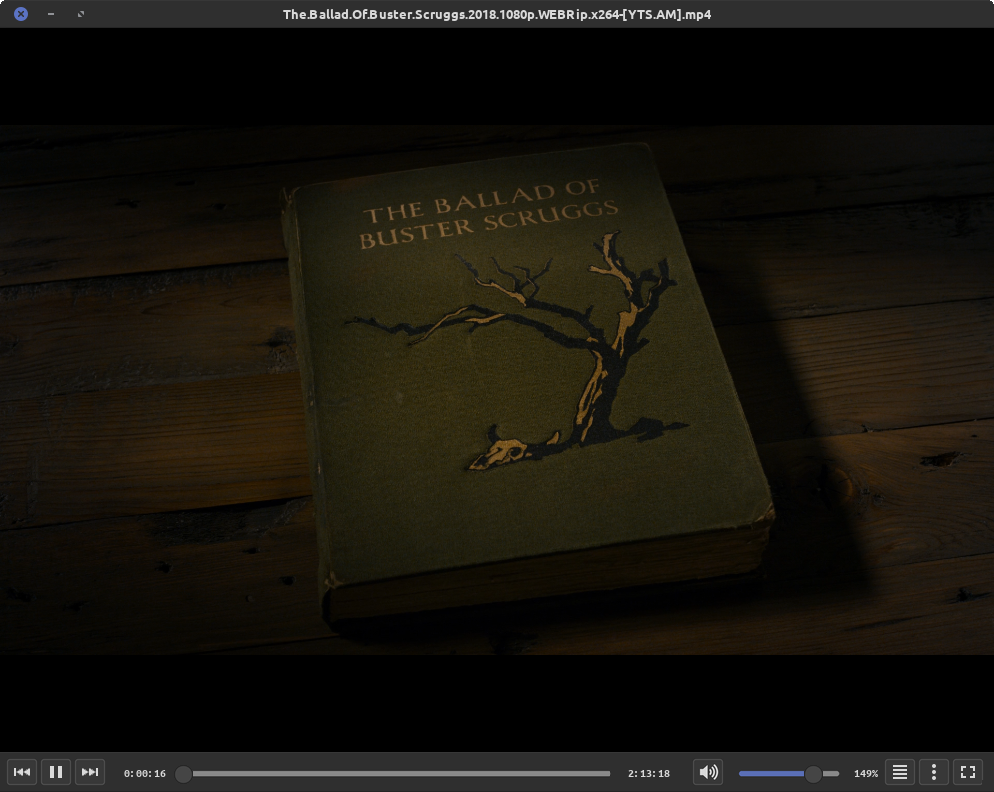

# Mint-L Dark Blue for VLC

A VLC skin that makes VLC look like a native Linux Mint application.

<p align="center">
  
</p>

<p align="center">
  <a href="https://github.com/RogerBytes/vlc-mint-l-dark-blue/releases/latest"></a>
  <a href="LICENSE"></a>
</p>

<p align="center">
  <a href="https://github.com/RogerBytes/vlc-mint-l-dark-blue/releases/latest">Latest release</a> ·
  <a href="#installation">Installation</a> ·
  <a href="#dark-right-click-menus">Dark menus</a> ·
  <a href="https://github.com/RogerBytes/vlc-mint-l-dark-blue/issues">Issues</a>
</p>

**Mint-L Dark Blue for VLC** is a skin for VLC 3 built to match the **Mint-L-Dark-Blue** theme of Linux Mint (Cinnamon). Colours, window buttons, title bar height, corner radius and fonts are all taken from the theme itself, so VLC blends in with the rest of your desktop.

## Features

- Native-looking title bar: real Mint-L window buttons, rounded top corners, centred file name, double-click to maximize/restore.
- Modern control bar: progress bar that stretches with the window, smooth volume bar up to 200%, and a speaker icon that follows the volume level (0 to 3 waves, crossed out when muted).
- Buttons, sliders and knobs drawn with the exact colours of Mint-L-Dark-Blue.
- Redesigned fullscreen controller: rounded floating panel with progress bar, playback controls, file name and volume.
- Resizable from the bottom-right corner and the bottom edge, from 640 × 428 up to any screen size.
- Two variants: window buttons on the **left** or on the **right**.

## Installation

The skin works with **VLC 3** (skins2 interface), native package or not, on X11 and Wayland.

<details><summary class="button">🔍 Spoiler</summary><div class="spoiler">

Download the variant you want from the [releases page](https://github.com/RogerBytes/vlc-mint-l-dark-blue/releases):

- `Mint-L-Dark-Blue.vlt` — window buttons on the left
- `Mint-L-Dark-Blue-Droite.vlt` — window buttons on the right

Move it to VLC's user skins folder (VLC finds skins there on its own):

```bash
mkdir -p ~/.local/share/vlc/skins2 && mv Mint-L-Dark-Blue*.vlt ~/.local/share/vlc/skins2/
```

Alternativly, you can install it on system

```bash
sudo cp Mint-L-Dark-Blue.vlt /usr/share/vlc/skins2/default.vlt
```

Then enable it in VLC:

1. Open **Tools → Preferences → Interface**.
2. Select **Use custom skin**.
3. In **Skin resource file**, choose the `.vlt` file from `~/.local/share/vlc/skins2/`.
4. Click **Save** and restart VLC.

**Uninstall:** go back to **Tools → Preferences → Interface**, select **Use native style**, save, restart VLC, then delete the `.vlt` file.

</div></details>

## Dark right-click menus

The right-click menu, the playlist and the preferences window are not drawn by the skin but by VLC's Qt interface. To get them dark too, Qt applications must follow your GTK theme.

<details><summary class="button">🔍 Spoiler</summary><div class="spoiler">

Check what Qt currently uses:

```bash
echo "$QT_QPA_PLATFORMTHEME $QT_STYLE_OVERRIDE"
dpkg -l | grep -E 'qt5-gtk|qt5-style-plugins|qt5ct|adwaita-qt'
```

Install the GTK integration for Qt 5 if it is missing:

```bash
sudo apt install -y qt5-style-plugins
```

Test it once, without changing anything:

```bash
QT_STYLE_OVERRIDE=gtk2 QT_QPA_PLATFORMTHEME=gtk2 vlc
```

If the right-click menu is dark, make it permanent. These commands append the settings at the end of the files, so they override any previous value:

```bash
printf '\n# Qt apps follow the GTK theme (Mint-L-Dark-Blue)\nexport QT_QPA_PLATFORMTHEME=gtk2\nexport QT_STYLE_OVERRIDE=gtk2\n' >> ~/.profile
```

```bash
printf '\n# Qt apps follow the GTK theme (Mint-L-Dark-Blue)\nexport QT_QPA_PLATFORMTHEME=gtk2\nexport QT_STYLE_OVERRIDE=gtk2\n' >> ~/.zshrc
```

Use `~/.bashrc` instead of `~/.zshrc` if your shell is bash. Then **log out and log back in**: `~/.profile` is only read when your session starts.

> [!NOTE]
> This applies to every Qt 5 application, not only VLC. The `gtk2` style only exists for Qt 5: if a future VLC moves to Qt 6, this setting will have to be redone for Qt 6.

</div></details>

## Tips

<details><summary class="button">🔍 Spoiler</summary><div class="spoiler">

- **Subtitles and audio tracks:** press **V** to cycle subtitle tracks and **B** to cycle audio tracks (VLC default shortcuts).
- **Half-screen snapping:** hold **Alt** and drag the window with the left mouse button from anywhere, video included. Cinnamon then moves the window itself, so edge snapping works. **Super + arrow keys** work too.
- **Fullscreen panel transparency:** **Tools → Preferences**, show settings **All**, then **Interface → Main interfaces → Qt → Fullscreen controller opacity** (default `0.8`).

</div></details>

## Known limitations

<details><summary class="button">🔍 Spoiler</summary><div class="spoiler">

These come from VLC's skin engine (skins2), not from the skin:

- The window can only be resized from the bottom-right corner and the bottom edge: skins2 has no left or top resize.
- The window cannot be dragged by the video area while playing: use **Alt + drag**.
- Dragging the title bar to a screen edge does not trigger Cinnamon's half-screen snapping: use **Alt + drag** or **Super + arrows**.
- The mouse cursor does not change shape over the resize areas.
- There is no subtitle button: skins2 offers no command to open the subtitle track list (use **V** or the right-click menu).
- Long titles scroll at a fixed speed set by VLC.

</div></details>

## License and credits

This skin is licensed under GPL-3.0 (see [`LICENSE`](LICENSE)), like the projects it derives from. It is a heavily reworked fork of [VLC Yaru Dark](https://github.com/feschukov/vlc-yaru-dark); window buttons and colours come from the [Mint-L](https://github.com/linuxmint/mint-l-theme) theme, and the Ubuntu fonts are under the Ubuntu Font Licence. Full details in [`CREDITS.md`](CREDITS.md).

## Author

[](https://github.com/RogerBytes)
[**RogerBytes (Harry Richmond)**](https://github.com/RogerBytes)

This project was developed with the help of an AI (Claude, by Anthropic). The author decides what it does, tests it and maintains it.
<span hidden>
<details><summary></summary>
<style>.spoiler{border-left:4px solid #1abc9c;border-bottom-left-radius:3px;padding-left:10px;padding-top:15px;margin-top:-10px;margin-bottom:15px}.button{cursor:pointer;padding:5px 10px;background-color:#3498db;color:white;border-radius:3px;margin-bottom:5px;display:inline-block;transition:background-color 0.2s}.button:hover{background-color:#217dbb}details[open] .button{background-color:#1abc9c}</style>
</details></span>

<p align="right"><a href="#mint-l-dark-blue-for-vlc">🔝 Back to top</a></p>

